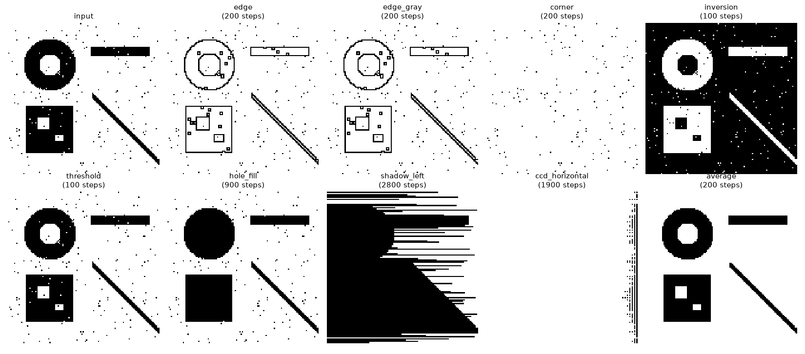

# cnnsim

**Chua–Yang cellular neural networks in PyTorch: fast GPU simulation and template learning.**

`cnnsim` simulates and trains **cellular neural networks** (CNNs) as introduced by Chua and Yang
(1988) — not to be confused with convolutional neural networks. A cellular neural network is a
grid of cells, each with a continuous state \(x_{ij}\) that follows an ordinary differential
equation. Every cell is coupled to its neighbourhood through two small templates: the feedback
template \(A\) acts on the outputs \(y\) of the neighbouring cells, the control template \(B\) on
a static input image \(u\), and a bias \(z\) shifts the operating point:

\[
\frac{dx_{ij}}{dt} = -x_{ij} + \sum_{k,l} A_{kl}\, y_{i+k,\,j+l} + \sum_{k,l} B_{kl}\, u_{i+k,\,j+l} + z,
\qquad y = f(x).
\]

The default output function is \(f(x) = \operatorname{clip}(x, -1, 1)\); by convention +1 is black
and −1 is white. The whole behaviour of the network is set by a handful of numbers. With classic
templates it performs image processing (edge and corner detection, hole filling,
connected-component detection); with general templates, output functions and boundaries it is a
flexible model of spatially extended nonlinear dynamics, and the templates can be learned from
data.



## Features

* **Fast simulation** of batches of networks — on the GPU with `torch.compile`, CUDA graphs and
  hand-written Triton kernels (billions of cell updates per second), or on the CPU.
* **A generalised model**: odd k×k templates, several output functions, fixed / zero-flux /
  periodic / closed-spiral boundaries, bias maps, and per-sample templates for parameter sweeps.
* **Template learning** by backpropagation through the dynamics (exact gradients, gradient
  checkpointing, many candidates trained in parallel), plus gradient-free baselines
  (simulated annealing, CMA-ES).
* **Classic templates** from the literature, checked by tests.

## Installation

```bash
pip install cnnsim
```

`cnnsim` needs Python ≥ 3.11 and PyTorch ≥ 2.8. pip installs PyTorch from PyPI; for a specific
CUDA build, install PyTorch first following the
[PyTorch instructions](https://pytorch.org/get-started/locally/). The fused Triton backend needs
an NVIDIA GPU and Triton, which ships with the Linux CUDA builds of PyTorch; everywhere else
`cnnsim` falls back to plain PyTorch. With PyTorch < 2.11, `compile=True` on the CPU also needs
`setuptools`, which those PyTorch versions use but do not declare.

## A first example

Fill the holes of a ring with the classic hole-filling template:

```python
import torch
from cnnsim import CNNSimulator, templates as T

# a ring: black (+1) on white (-1)
yy, xx = torch.meshgrid(torch.arange(64), torch.arange(64), indexing="ij")
r = ((yy - 32) ** 2 + (xx - 32) ** 2).sqrt()
u = torch.where((r > 12) & (r < 18), 1.0, -1.0)

sim = CNNSimulator()  # GPU if available
res = sim.run(T.HOLE_FILL, u, steps=2000, dt=0.1, tol=1e-3)
y = res["y"]  # (1, 1, 64, 64): the ring with its inside filled black
print(res["steps"], (y > 0).float().mean().item())
```

Continue with the [user guide](guide/simulation.md), or browse the
[API reference](api/cnnsim.md).

## Citing

If you use `cnnsim` in your research, please cite it via its
[Zenodo DOI](https://doi.org/10.5281/zenodo.24574054) (the
[CITATION.cff](https://github.com/thorstenkranz/cnnsim/blob/main/CITATION.cff) file has the
details; GitHub shows a *Cite this repository* button), and the original paper:

> L. O. Chua and L. Yang, "Cellular neural networks: theory," *IEEE Transactions on Circuits
> and Systems*, vol. 35, no. 10, pp. 1257–1272, 1988.
> [doi:10.1109/31.7600](https://doi.org/10.1109/31.7600)

## Versioning

`cnnsim` follows [semantic versioning](https://semver.org). Before 1.0, a minor release
(0.x → 0.x+1) may contain breaking changes, which are marked in the [changelog](changelog.md);
patch releases only fix bugs. The public API is what these pages document: the names exported by
`cnnsim` and its modules without a leading underscore.

## License

MIT, see [LICENSE](https://github.com/thorstenkranz/cnnsim/blob/main/LICENSE).
